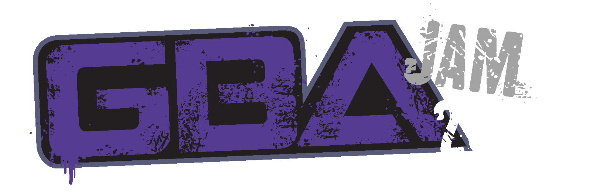

> The event was hosted by the the [gbadev.net](https://gbadev.net) community. We're promoting the development of new GBA homebrew games, development tools and documentation. Join us on [Discord or IRC](/chat.html) and check out our [curated collection of gbadev resources](/resources.html).

This year we ran another GBA Jam, which had an incredible turnout! There were _so many_ high quality entries (56 in total), with several ties among them. It was real tough to pick out the winners.

A huge thank you and congratulations to everyone who took part, as well as [everyone who donated](https://opencollective.com/gbadev/projects/gbajam26) to the prize pool, our fellow organisers and judges. Finally, thanks to our generous sponsors, whose support made this event possible:

[incube8 Games](https://incube8games.com/), [insideGadgets](https://shop.insidegadgets.com/), [Epilogue](https://www.epilogue.co/), [Bitmap Bureau](https://www.bitmapbureau.com/) and [Game Bub](https://gamebub.net/).

If you've played and enjoyed the entries so far, then a special thanks to you too. If you _haven't_ then... you know what to do. \:\)

## Results

Prize winners are marked in **bold**, open-source bonus is denoted by ﹢.

A [four-way tie break](#tie-breaks) was required for 6th place due to the physical prize, other ties have been left as-is.

Full detailed results for all 56 entries can be found on the [itch.io results page](https://itch.io/jam/gbajam26/results).

### Overall (Top 20)

<ol>
	<li value="1"><a href="https://setsquare.itch.io/damage-report"><strong>Damage Report</strong></a> by Tapir Labs</li>
	<li value="2"><a href="https://gordonshamway23.itch.io/it-matters"><strong>It Matters</strong></a> by gordonshamway23, WTBasil</li>
	<li value="3"><a href="https://setsquare.itch.io/dungeon-tactics">Dungeon Tactics</a> by Tapir Labs</li>
	<li value="4"><a href="https://eragnarok.itch.io/the-artifact"><strong>The Artifact</strong></a> by Reggie and Qwertyman ﹢</li>
	<li value="5"><a href="https://daretosquare.itch.io/dare-to-doku"><strong>Dare To Doku</strong></a> by Homebrew Twins</li>
	<li value="6"><a href="https://saraitakemoto.itch.io/pinball-galaxy-demo-ver"><strong>Pinball Galaxy Demo Ver</strong></a> by Sarai Takemoto</li>
	<li value="7"><a href="https://dreamnoid.itch.io/starfall-advance"><strong>Starfall Advance</strong></a> by Dreamnoid</li>
	<li value="8"><a href="https://coffeepasta.itch.io/witchxbullet"><strong>Witch×Bullet</strong></a> by CoffeePasta</li>
	<li value="9"><a href="https://lipucka.itch.io/mordoboy-gba"><strong>Mordoboy GBA</strong></a> by lipucka ﹢</li>
	<li value="10"><a href="https://stuck-pixel-studio.itch.io/knock-time"><strong>Knock Time</strong></a> by Stuck Pixel Studio</li>
	<li value="11"><a href="https://origamiscienceguy.itch.io/forever-witch-fighter-gba">Forever Witch Fighter GBA</a> by origamiscienceguy ﹢</li>
	<li value="12">
		<a href="https://xcelfr.itch.io/breakoid">Breakoid</a> by CeL, JPtom, Cyberdeous 
		<a href="https://nostabyte.itch.io/xo89">xo89</a> by Nostabyte Interactive 
		<a href="https://fralacticus.itch.io/ounfo-tan-sispann">Ounfò Tan Sispann</a> by Fralacticus 
	</li>
	<li value="15">
		<a href="https://drkylstein.itch.io/a-betty-and-claude-cartoon">A Betty and Claude Cartoon</a> by OutOfSync 
		<a href="https://christopherthompsonut.itch.io/paladado-demo">Paladado Demo</a> by ChristopherThompsonUT 
	</li>
	<li value="17">
		<a href="https://soingamedev.itch.io/tiny-relic-quest-gba-edition">Tiny Relic Quest - GBA Edition</a> by Soin GameDev 
		<a href="https://glitchcauldron.itch.io/ambushed">Auguries from the Mist: Ambushed</a> by Glitch Cauldron 
		<a href="https://zegalur.itch.io/noonlight-paradox">Noonlight Paradox</a> by zegalur 
	</li>
	<li value="20"><a href="https://pyro-pyro.itch.io/antibody">Antibody</a> by Pyro_Pyro, exelotl, ReyOruga, Pixel _Jamp</li>
</ol>

### Technical

<ol>
	<li value="1"><a href="https://fralacticus.itch.io/ounfo-tan-sispann">Ounfò Tan Sispann</a> by Fralacticus</li>
	<li value="2"><a href="https://codename-b.itch.io/gba-gb-maps">GBA GB Maps</a> by codename_B</li>
	<li value="3"><a href="https://factor64.itch.io/wfx">WFX</a> by Factor</li>
	<li value="4">
		<a href="https://drkylstein.itch.io/a-betty-and-claude-cartoon">A Betty and Claude Cartoon</a> by OutOfSync 
		<a href="https://codename-b.itch.io/gba-minesweeper-6d">GBA MINESWEEPER 6D</a> by codename_B 
	</li>
</ol>

### Originality

<ol>
	<li value="1">
		<a href="https://drkylstein.itch.io/a-betty-and-claude-cartoon">A Betty and Claude Cartoon</a> by OutOfSync 
		<a href="https://gordonshamway23.itch.io/it-matters">It Matters</a> by gordonshamway23, WTBasil 
		<a href="https://glitchcauldron.itch.io/ambushed">Auguries from the Mist: Ambushed</a> by Glitch Cauldron 
	</li>
	<li value="4"><a href="https://eragnarok.itch.io/the-artifact">The Artifact</a> by Reggie and Qwertyman</li>
	<li value="5"><a href="https://copyrat90.itch.io/mimiclime">mimiclime</a> by copyrat90</li>
</ol>

### Graphics

<ol>
	<li value="1"><a href="https://stuck-pixel-studio.itch.io/knock-time">Knock Time</a> by Stuck Pixel Studio</li>
	<li value="2">
		<a href="https://zegalur.itch.io/noonlight-paradox">Noonlight Paradox</a> by zegalur 
		<a href="https://setsquare.itch.io/dungeon-tactics">Dungeon Tactics</a> by Tapir Labs 
	</li>
	<li value="4">
		<a href="https://gordonshamway23.itch.io/it-matters">It Matters</a> by gordonshamway23, WTBasil 
		<a href="https://xcelfr.itch.io/breakoid">Breakoid</a> by CeL, JPtom, Cyberdeous 
	</li>
</ol>

### Audio

<ol>
	<li value="1"><a href="https://setsquare.itch.io/dungeon-tactics">Dungeon Tactics</a> by Tapir Labs</li>
	<li value="2"><a href="https://setsquare.itch.io/damage-report">Damage Report</a> by Tapir Labs</li>
	<li value="3"><a href="https://pyro-pyro.itch.io/antibody">Antibody</a> by Pyro_Pyro, exelotl, ReyOruga, Pixel _Jamp</li>
	<li value="4">
		<a href="https://vhaugan.itch.io/sleepyheads">Sleepyheads</a> by VHaugan 
		<a href="https://stuck-pixel-studio.itch.io/knock-time">Knock Time</a> by Stuck Pixel Studio 
		<a href="https://daretosquare.itch.io/dare-to-doku">Dare To Doku</a> by Homebrew Twins 
	</li>
</ol>

### Polish

<ol>
	<li value="1"><a href="https://daretosquare.itch.io/dare-to-doku">Dare To Doku</a> by Homebrew Twins</li>
	<li value="2"><a href="https://setsquare.itch.io/damage-report">Damage Report</a> by Tapir Labs</li>
	<li value="3"><a href="https://gordonshamway23.itch.io/it-matters">It Matters</a> by gordonshamway23, WTBasil</li>
	<li value="4"><a href="https://setsquare.itch.io/dungeon-tactics">Dungeon Tactics</a> by Tapir Labs</li>
	<li value="5"><a href="https://saraitakemoto.itch.io/pinball-galaxy-demo-ver">Pinball Galaxy Demo Ver</a> by Sarai Takemoto</li>
</ol>

## Judging and Prizes

The GBA Jam 2026 submissions were judged by: PyroPyro, GValiente, kva64, exelotl, colonelsalt, lifning, evanbowman, skylyrac, Afska.

If you won a prize, we'll be in touch via email over the next few days! More details on how the prizes were calculated can be found [here](https://docs.google.com/spreadsheets/d/18HiP8yiHfW9WHJApQV5T8QkLqSpo76irSYLod5Q2E0c/edit?usp=sharing).

As per our policy on multiple entries from a single team, Damage Report and Dungeon Tactics (both made by Tapir Labs) claimed both 1st and 3rd place, they will keep their score placement but will only be eligible to claim prizes for their highest ranking game, Damage Report. The prize structure for 3rd place and below will shift down 1 level.

### Physical Prizes

The top 9 participants can choose from the following pool. We'll contact winners in descending order; the first 3 prizewinners may pick 2 items each, and everyone else may pick one.

- 2 × [Discrete Orange](https://incube8games.com/en-eu/products/discrete-orange-gba) for Game Boy Advance, courtesy of Incube8 Games
- 2 × [Kien](https://incube8games.com/en-eu/products/kien-gba) for Game Boy Advance, courtesy of Incube8 Games
- 3 × [GBxCart RW](https://www.gbxcart.com/) cartridge flasher/dumper, courtesy of insideGadgets
- 1 × [GB Operator](https://www.epilogue.co/product/gb-operator) cartridge flasher/dumper, courtesy of Epilogue
- 3 × [Xeno Crisis](https://shop.bitmapbureau.com/products/xeno-crisis-gba) for Game Boy Advance, courtesy of Bitmap Bureau
- 1 × [Game Bub](https://www.crowdsupply.com/second-bedroom/game-bub) FPGA retro-emulation handheld, courtesy of Eli Lipsitz

### Money Prizes

* 1st place - $653
* 2nd place - $261
* 3rd place - $163
* 4th place - $131
* 5th place - $98

### Open source bonus

Additional prize money is given to the top 3 entries whose source code was released under a free-software license.

* 1st - $163
* 2nd - $98
* 3rd - $65

### Tie-breaks

Tie-breaks have been applied only where necessary for physical prizes to be assigned. Consequently we had to resolve a 2-way tie for 1st place between *Damage Report* and *It matters*, a 2-way tie for 3rd place between *Dungeon Tactics* and *The Artifact*, and 4-way tie for 6th place between *MORDOBOY GBA*, *Starfall Advance*, *Witch×Bullet*, and *Pinball Galaxy Demo Ver*.

To break the ties, we ran 8 polls in parallel, asking judges to vote on which of each pair of games they liked the most. This gave the following results:

#### 1st Place

<table>
	<tbody><tr>
		<td height="17" align="right"> </td>
		<td colspan="1" align="center">Tiebreak poll outcomes:</td>
		<td align="center">Total</td>
	</tr>
	<tr>
		<td align="right">Damage Report</td>
		<td align="center">5</td>
		<td align="center"><b>5</b></td>
	</tr>
	<tr>
		<td align="right">It Matters</td>
		<td align="center">4</td>
		<td align="center"><b>4</b></td>
	</tr>
	</tbody>
</table>

#### 3rd Place

<table>
	<tbody><tr>
		<td height="17" align="right"> </td>
		<td colspan="1" align="center">Tiebreak poll outcomes:</td>
		<td align="center">Total</td>
	</tr>
	<tr>
		<td align="right">Dungeon Tactics</td>
		<td align="center">6</td>
		<td align="center"><b>6</b></td>
	</tr>
	<tr>
		<td align="right">The Artifact</td>
		<td align="center">3</td>
		<td align="center"><b>3</b></td>
	</tr>
	</tbody>
</table>

#### 6th Place

<table>
	<tbody><tr>
		<td height="17" align="right"> </td>
		<td colspan="6" align="center">Tiebreak poll outcomes:</td>
		<td align="center">Total</td>
	</tr>
	<tr>
		<td align="right">Pinball Galaxy Demo Ver</td>
		<td align="center"> </td>
		<td align="center">4</td>
		<td align="center">6</td>
		<td align="center"> </td>
		<td align="center"> </td>
		<td align="center">6</td>
		<td align="center"><b>16</b></td>
	</tr>
	<tr>
		<td align="right">Starfall Advance</td>
		<td align="center">6</td>
		<td align="center"> </td>
		<td align="center">3</td>
		<td align="center"> </td>
		<td align="center">5</td>
		<td align="center"> </td>
		<td align="center"><b>14</b></td>
	</tr>
	<tr>
		<td align="right">Witch×Bullet</td>
		<td align="center"> </td>
		<td align="center">5</td>
		<td align="center"> </td>
		<td align="center">4</td>
		<td align="center">4</td>
		<td align="center"> </td>
		<td align="center"><b>13</b></td>
	</tr>
	<tr>
		<td align="right">MORDOBOY GBA</td>
		<td align="center">3</td>
		<td align="center"> </td>
		<td align="center"> </td>
		<td align="center">5</td>
		<td align="center"> </td>
		<td align="center">3</td>
		<td align="center"><b>11</b></td>
	</tr>
	</tbody>
</table>

Using a round robin tournament structure for these polls, *Pinball Galaxy Demo Ver* and *Starfall Advance* drew with 2 wins each. We used the total votes to resolve the final order.